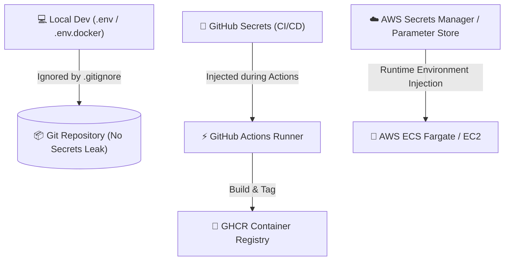

# 🛡️ Day 23: Branch Protection & CI Quality Gates Guide

Branch protection guarantees that no unvalidated code, failing tests, or unreviewed pull requests can ever enter the production branch (`main` or `master`). This is the foundation of high-velocity, zero-downtime DevOps.

---

## 🏗️ The 4 Required CI Status Checks

Before a Pull Request can be merged into `main`, GitHub Actions automatically runs the following 4 parallel and dependent jobs:

| Status Check Name | Scope | Tools Used | Merge Requirement |
| :--- | :--- | :--- | :--- |
| **`Backend Pytest & Code Quality`** | Python 3.11 linting, syntax validation, and automated backend test suite | `flake8`, `pytest`, `pytest-cov`, `FastAPI TestClient` | **Mandatory** (Must pass 100%) |
| **`Frontend TypeScript, Vitest & Vite Build`** | TypeScript type safety, 68 Vitest component tests, and Vite production bundle | `tsc --noEmit`, `vitest run`, `vite build` | **Mandatory** (Must pass 100%) |
| **`Dockerfile & Compose Syntax Validation`** | Validates `docker-compose.yml` schema, multi-stage stages (`builder`, `runtime`, `runner`), and non-root security | `docker compose config`, `Hadolint` rules | **Mandatory** (Must pass 100%) |
| **`Docker Multi-Stage Build & Image Push`** | Compiles multi-stage Docker images with layer caching and tags for GHCR | `docker/build-push-action@v5`, `ghcr.io` | **Mandatory** (Must pass 100%) |

---

## 🔒 Branch Protection Rules Enforced

1. **Require a pull request before merging:**
   - Direct pushes to `main` are strictly blocked.
   - Requires at least **1 approving review** from a peer engineer or maintainer.
   - Automatically dismisses stale reviews when new commits are pushed.

2. **Require status checks to pass before merging:**
   - Strict mode enabled: Branch must be up to date with `main` before merging.
   - All 4 required CI checks listed above must report **green (success)**.

3. **Require conversation resolution:**
   - All review comments, inline questions, or feedback threads must be resolved.

4. **Require linear history:**
   - Enforces clean Git history via Squash and Merge or Rebase Merge (no messy merge commits).

5. **Do not allow force pushes (`git push --force`) & prevent branch deletions:**
   - Protects Git commit history from accidental overwrite or deletion.

6. **Enforce rules for administrators (`enforce_admins = true`):**
   - Even repository owners cannot bypass tests or merge red builds.

---

## 🚀 How to Apply These Rules

### Option A: Automated via GitHub CLI (Recommended)
Run the automated script included in this repository:
```powershell
cd 23_devops_aws_focus
.\scripts\configure_branch_protection.ps1 -Repo "Venkata-Narasimha-11/coastal-seven" -Branch "main"
```

### Option B: GitHub Web UI Settings
1. Go to your repository on [GitHub](https://github.com/Venkata-Narasimha-11/coastal-seven).
2. Click **Settings** ➔ **Branches** ➔ **Add branch protection rule**.
3. Branch name pattern: `main`.
4. Check **Require a pull request before merging**:
   - Require approvals: `1`
   - Dismiss stale pull request approvals when new commits are pushed: `Checked`
5. Check **Require status checks to pass before merging**:
   - Require branches to be up to date before merging: `Checked`
   - In the search box, search and select:
     - `Backend Pytest & Code Quality`
     - `Frontend TypeScript, Vitest & Vite Build`
     - `Dockerfile & Compose Syntax Validation`
     - `Docker Multi-Stage Build & Image Push`
6. Check **Require conversation resolution before merging**.
7. Check **Do not allow force pushes**.
8. Check **Do not allow deletions**.
9. Click **Create** or **Save changes**.

---

## 🔐 Environment & Secret Management Architecture



### Secret Storage Breakdown:
1. **Local Development:**
   - Stored in `.env` or `.env.docker`.
   - Never committed to source control (strictly blocked in `.gitignore` and `.dockerignore`).
2. **GitHub Actions CI/CD:**
   - Stored in **Repo Settings ➔ Secrets and variables ➔ Actions**:
     - `DOCKERHUB_USERNAME` / `DOCKERHUB_TOKEN` (optional for Docker Hub)
     - `GITHUB_TOKEN` (automatically provided by GitHub Actions for GHCR)
     - `GROQ_API_KEY`, `GEMINI_API_KEY` (injected during testing or deployment)
3. **AWS Production Deployment:**
   - Stored in **AWS Secrets Manager** or **AWS Systems Manager Parameter Store**:
     - `/sivora/production/DATABASE_URL`
     - `/sivora/production/REDIS_URL`
     - `/sivora/production/SECRET_KEY`
   - Injected securely at container launch via ECS task definitions without ever hardcoding in Dockerfiles.
