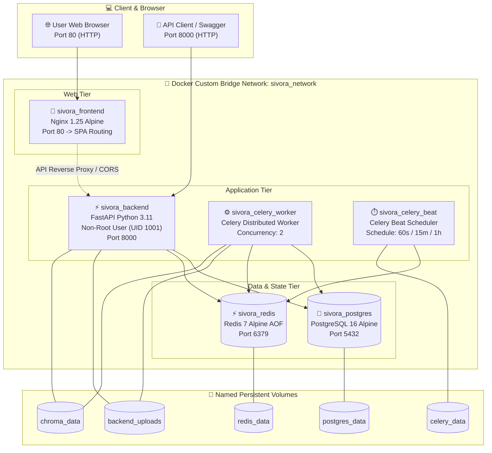
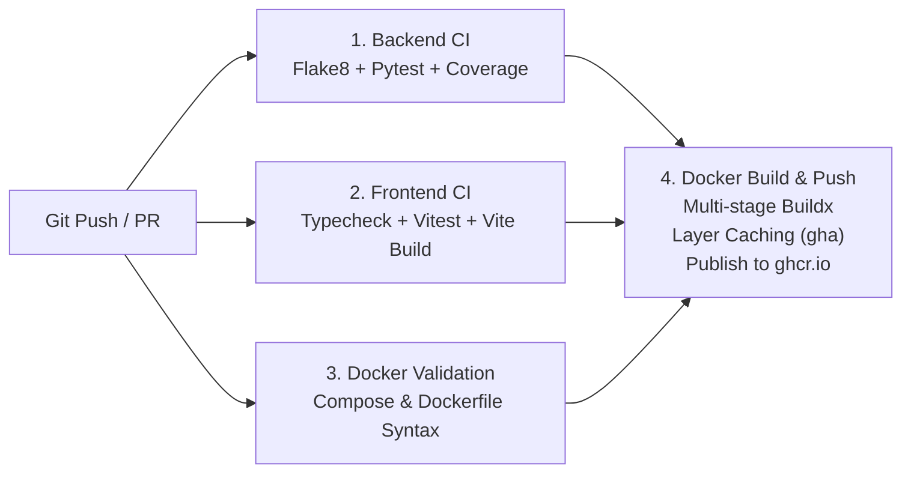

# Day 23: DEVOPS / AWS FOCUS — Full-Stack Containerization, Docker Compose, CI/CD & Cloud Governance

Welcome to **Day 23** of the Full-Stack Engineering Bootcamp! This directory contains the complete, production-grade implementation of **Day 23 – DEVOPS / AWS FOCUS**, integrating all previous days (Days 1–22) into a production-hardened containerized architecture with multi-stage Dockerfiles, Docker Compose service orchestration, automated GitHub Actions CI/CD pipelines, container registry publishing, and branch protection quality gates.

---

## 🎯 Syllabus & Key Deliverables Implemented

| Topic | Learning & Implementation | Delivered Feature & Implementation |
| :--- | :--- | :--- |
| **Docker Fundamentals** | Understand Docker images, containers, layers, and build multi-stage Dockerfiles for FastAPI and Next.js / React | Multi-stage Dockerfiles: [`backend/Dockerfile`](file:///c:/Users/venka/Desktop/Narasimha/23_devops_aws_focus/backend/Dockerfile) (Python 3.11 builder & non-root `appuser` runtime) and [`frontend/Dockerfile`](file:///c:/Users/venka/Desktop/Narasimha/23_devops_aws_focus/frontend/Dockerfile) (Node 20 builder & ultra-light Nginx Alpine runtime) + [`frontend/Dockerfile.nextjs`](file:///c:/Users/venka/Desktop/Narasimha/23_devops_aws_focus/frontend/Dockerfile.nextjs) (Next.js standalone runner). |
| **Docker Compose** | Configure FastAPI, PostgreSQL, Redis, Celery worker, and Celery Beat as services using Docker Compose | [`docker-compose.yml`](file:///c:/Users/venka/Desktop/Narasimha/23_devops_aws_focus/docker-compose.yml) orchestrating 6 services: `postgres`, `redis`, `backend`, `celery_worker`, `celery_beat`, and `frontend` with healthcheck dependencies. |
| **GitHub Actions CI** | Configure automated workflows for pytest, Vitest, linting, and Docker image builds | [`.github/workflows/day23-devops-ci.yml`](file:///c:/Users/venka/Desktop/Narasimha/.github/workflows/day23-devops-ci.yml) executing Flake8 linting, Pytest test suite with coverage, TypeScript typecheck, and 68 Vitest tests on every push. |
| **Docker Build & Push** | Automate Docker image building and publishing through GitHub Actions | Buildx multi-stage image generation with GitHub Actions cache (`type=gha`) publishing tagged container images to GitHub Container Registry (`ghcr.io`). |
| **Branch Protection** | Configure branch protection rules and required CI status checks before merging pull requests | [`.github/branch-protection-rules.json`](file:///c:/Users/venka/Desktop/Narasimha/.github/branch-protection-rules.json) and [`scripts/configure_branch_protection.ps1`](file:///c:/Users/venka/Desktop/Narasimha/23_devops_aws_focus/scripts/configure_branch_protection.ps1) enforcing 4 mandatory checks, PR review approval, and blocking force pushes. |
| **Docker Networking & Volumes** | Configure service-to-service networking and named volumes for persistent database and application data | Custom bridge network `sivora_network` for secure inter-service DNS resolution, plus 5 named volumes (`postgres_data`, `redis_data`, `backend_uploads`, `chroma_data`, `celery_data`). |
| **Environment & Secret Management** | Manage environment variables and application secrets securely across local development and CI/CD workflows | [`.env.docker`](file:///c:/Users/venka/Desktop/Narasimha/23_devops_aws_focus/.env.docker), [`.env.example`](file:///c:/Users/venka/Desktop/Narasimha/23_devops_aws_focus/.env.example), `.dockerignore`, and comprehensive AWS Secrets Manager architecture documentation in [`BRANCH_PROTECTION.md`](file:///c:/Users/venka/Desktop/Narasimha/23_devops_aws_focus/BRANCH_PROTECTION.md). |
| **Final Integration** | Containerize the full-stack application and integrate Docker Compose, GitHub Actions, automated testing, linting, and container publishing | Full stack runnable with a single command (`docker compose up --build -d`) and verified with 23 passing Pytest tests and 68 passing Vitest tests. |

---

## 🏗️ System Architecture & Container Topology



---

## ⚙️ Service-to-Service Networking & Persistence

In this architecture, each container resolves peer services using Docker's embedded DNS server across the isolated bridge network `sivora_network`:

1. **`postgres` (PostgreSQL 16):**
   - Hostname: `postgres:5432`
   - Volume: `postgres_data` mounted at `/var/lib/postgresql/data` (preserves catalog, orders, and users across restarts).
   - Healthcheck: `pg_isready -U postgres -d ecommerce_db`.
2. **`redis` (Redis 7):**
   - Hostname: `redis:6379`
   - Volume: `redis_data` mounted at `/data` with Append-Only File (`AOF`) persistence.
   - Healthcheck: `redis-cli ping`.
3. **`backend` (FastAPI):**
   - Hostname: `backend:8000`
   - Depends on: `postgres` (healthy) and `redis` (healthy).
   - Storage: `backend_uploads` for PDF invoices/images, `chroma_data` for RAG vector embeddings.
   - Healthcheck: `curl -f http://localhost:8000/health`.
4. **`celery_worker` (Background Tasks):**
   - Asynchronous worker for PDF invoice rendering, bulk CSV product import, vector re-indexing, and batch LLM descriptions.
5. **`celery_beat` (Periodic Job Scheduler):**
   - Dispatches cron-like recurring jobs:
     - `periodic-health-heartbeat`: every 60 seconds (records worker liveness).
     - `periodic-cache-cleanup`: every 15 minutes (cleans expired temporary Redis keys).
     - `periodic-catalog-sync`: every hour (verifies database count vs vector index count).
   - Volume: `celery_data` preserves schedule state across restarts.
6. **`frontend` (React + Nginx):**
   - Port `80` serving optimized static assets with SPA routing (`try_files $uri $uri/ /index.html;`), gzip compression, and security headers.

---

## 🚀 Single-Command Orchestration

To run the complete production application stack locally:

```bash
# 1. Navigate to the Day 23 directory
cd 23_devops_aws_focus

# 2. Launch all 6 services with build and detached mode
docker compose up --build -d
```

### Stack Endpoints:
* **React Storefront & Admin:** `http://localhost:80`
* **FastAPI Backend OpenAPI Docs:** `http://localhost:8000/docs`
* **FastAPI Health Verification:** `http://localhost:8000/health`
* **PostgreSQL Database:** `localhost:5432` (User: `postgres`, DB: `ecommerce_db`)
* **Redis Cache & Broker:** `localhost:6379`

### Inspect Logs & Service Status:
```bash
# View live logs across all containers
docker compose logs -f

# Check container health and status
docker compose ps

# Gracefully stop the stack
docker compose down
```

---

## 🛡️ GitHub Actions CI/CD Pipeline

The automated CI/CD pipeline at [`.github/workflows/day23-devops-ci.yml`](file:///c:/Users/venka/Desktop/Narasimha/.github/workflows/day23-devops-ci.yml) triggers on every push and pull request:



1. **`backend-ci`**:
   - Python 3.11 with pip layer caching.
   - Flake8 syntax checks.
   - Pytest execution for all 23 backend automated tests.
2. **`frontend-ci`**:
   - Node 20 with npm dependency caching.
   - Strict TypeScript validation (`npm run typecheck`).
   - 68 Vitest component tests (`npm run test:run`).
   - Production Vite bundle compilation (`npm run build`).
3. **`docker-validation`**:
   - Validates `docker-compose.yml` config using `docker compose config --quiet`.
   - Validates multi-stage stages (`builder`, `runtime`, `runner`) and non-root security standards.
4. **`docker-build-push`**:
   - Builds backend and frontend multi-stage container images using Docker Buildx.
   - Pushes images with `latest` and commit SHA tags to GitHub Packages (`ghcr.io`).

---

## 🧪 Automated Testing & Verification

### Run Backend Tests (23 Tests passing 100%):
```powershell
cd 23_devops_aws_focus/backend
.\.venv\Scripts\pytest.exe tests/test_day22_ai_project.py tests/test_day23_devops.py -v
```

### Run Frontend Tests (68 Tests passing 100%):
```powershell
cd 23_devops_aws_focus/frontend
npm.cmd run typecheck
npm.cmd run test:run
npm.cmd run build
```

---

## 📁 Key File Index

* **Full-Stack Docker Compose:** [`docker-compose.yml`](file:///c:/Users/venka/Desktop/Narasimha/23_devops_aws_focus/docker-compose.yml)
* **Backend Multi-Stage Dockerfile:** [`backend/Dockerfile`](file:///c:/Users/venka/Desktop/Narasimha/23_devops_aws_focus/backend/Dockerfile)
* **Backend .dockerignore:** [`backend/.dockerignore`](file:///c:/Users/venka/Desktop/Narasimha/23_devops_aws_focus/backend/.dockerignore)
* **Frontend Multi-Stage Dockerfile (React/Vite):** [`frontend/Dockerfile`](file:///c:/Users/venka/Desktop/Narasimha/23_devops_aws_focus/frontend/Dockerfile)
* **Next.js Multi-Stage Dockerfile:** [`frontend/Dockerfile.nextjs`](file:///c:/Users/venka/Desktop/Narasimha/23_devops_aws_focus/frontend/Dockerfile.nextjs)
* **Production Nginx Configuration:** [`frontend/nginx.conf`](file:///c:/Users/venka/Desktop/Narasimha/23_devops_aws_focus/frontend/nginx.conf)
* **Celery Beat Scheduled Tasks:** [`backend/app/services/celery_app.py`](file:///c:/Users/venka/Desktop/Narasimha/23_devops_aws_focus/backend/app/services/celery_app.py#L43-L58)
* **GitHub Actions CI/CD Workflow:** [`.github/workflows/day23-devops-ci.yml`](file:///c:/Users/venka/Desktop/Narasimha/.github/workflows/day23-devops-ci.yml)
* **Branch Protection Rules Definition:** [`.github/branch-protection-rules.json`](file:///c:/Users/venka/Desktop/Narasimha/.github/branch-protection-rules.json)
* **Branch Protection Automation Script:** [`scripts/configure_branch_protection.ps1`](file:///c:/Users/venka/Desktop/Narasimha/23_devops_aws_focus/scripts/configure_branch_protection.ps1)
* **Branch Protection & Secrets Guide:** [`BRANCH_PROTECTION.md`](file:///c:/Users/venka/Desktop/Narasimha/23_devops_aws_focus/BRANCH_PROTECTION.md)
* **Day 23 Automated Test Suite:** [`backend/tests/test_day23_devops.py`](file:///c:/Users/venka/Desktop/Narasimha/23_devops_aws_focus/backend/tests/test_day23_devops.py)
